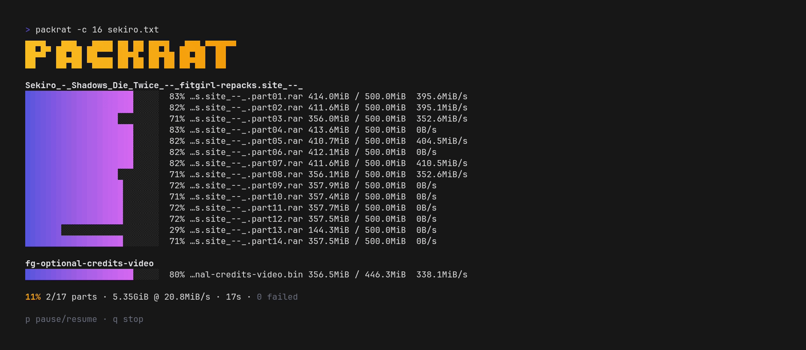

# packrat

**🐀 Hauls every part of your big downloads — concurrent, resumable, single Go binary.**

[](https://github.com/EliasLd/packrat/releases/latest)
[](https://github.com/EliasLd/packrat/actions/workflows/ci.yml)
[](https://github.com/EliasLd/packrat)

packrat is a cross-platform downloader for multi-part file hosting, made
for grabbing **FitGirl repacks** from the terminal: it reads a text file
of the repack's landing-page links, resolves each one to its direct
download link, and fetches every part concurrently into one directory per
archive.



## Features

- Plain text input: one link per line, markdown bullets welcome, broken lines skipped with a note instead of failing the run.
- One output directory per archive, parts kept together and ordered.
- Live progress view with per-part bars, speed and a pause/resume key.
- Script-friendly `--plain` output that honors `NO_COLOR`.
- Byte-exact resume: interrupted runs keep `.part` files, rerunning the same command continues where it stopped.
- Graceful stop that preserves partial parts, plus explicit exit codes for scripting.
- Automatic retries with backoff; host-imposed `Retry-After` pauses are honored instead of hammered.
- Polite link resolution: paced and jittered requests, live cooldown display, and sustained rate limiting ends the run early with a clear rerun-later message.
- Resolves without a real browser: pages are fetched with a TLS fingerprint that impersonates one.
- `--dry-run` to preview the download plan before touching the network.
- Native binaries for Linux, macOS and Windows.

## Quick start

[**Download the latest version**](https://github.com/EliasLd/packrat/releases/latest)

Copy your repack's part links into a text file (one per line), then run:

```bash
./packrat links.txt
```

## Supported providers

| Provider | Website |
| --- | --- |
| FuckingFast | https://fuckingfast.co |

> [!NOTE]
> Requests toward the provider are paced and jittered, and rate-limit
> answers are waited out exactly as the host asks for. Politeness is what
> keeps long runs working.

> [!TIP]
> The engine/host seams make adding a provider a small, isolated job.
> Pull requests are welcome.

## Installation

### Windows

1. Download the Windows archive from the [latest release](https://github.com/EliasLd/packrat/releases/latest).
2. Extract it to a directory of your choice.
3. Open PowerShell or CMD in that directory and run `packrat.exe` on a links file.

### Linux / macOS

Download the archive matching your platform, extract it and make the binary executable:

```bash
tar -xzf packrat-macos-arm64.tar.gz
chmod +x packrat
```

Optionally move it somewhere available in your `PATH`:

```bash
sudo mv packrat /usr/local/bin/
```

### Build from source

Clone the repository and build the binary:

```bash
git clone https://github.com/EliasLd/packrat.git
cd packrat
go build -o packrat ./cmd/packrat
```

## Usage

### Basic syntax

```bash
packrat [options] links.txt
```

Options must come before the links file.

### Options

| Option | Description |
| --- | --- |
| `-o dir` | Output root directory. Default: `downloads`. |
| `-c int` | Parallel downloads. Default: `8`. |
| `-rc int` | Parallel link resolutions. Default: `3`. |
| `-retries int` | Attempts per part. Default: `5`. |
| `--plain` | Never style the output — for pipes, CI and logs. |
| `--dry-run` | Print the planned download layout, resolve and download nothing. |
| `--version` | Print the build version and exit. |

### The links file

```text
# one link per line; '- ' bullets and [text](url) markdown links work too
https://fuckingfast.co/AbC123#MyGame.repack.part01.rar
- https://fuckingfast.co/DeF456#MyGame.repack.part02.rar
```

The URL fragment names the download: a `<name>.part01.rar` style fragment
downloads into `downloads/<name>/` and keeps every part in order:

```text
downloads/
└── MyGame.repack/
    ├── MyGame.repack.part01.rar
    ├── MyGame.repack.part02.rar
    └── MyGame.repack.part03.rar
```

Without a fragment, the part lands in `unknown/` and keeps the file name
the host page provides.

### Pause, stop, resume

While downloading on a terminal:

- `p` pauses and unpauses the whole run.
- `q` or `ctrl-c` stops gracefully; unfinished parts stay as safe `.part` files.
- Rerun the exact same command afterwards to resume.

When the host asks for patience, the view says so instead of pretending:

```text
[rate limit] cooling 30s: host rate limit (status 429): retry after 30s
```

### Exit codes

```text
0      ok
1      some part(s) failed
2      bad usage
130    interrupted
```

## Examples

### Choose another output root

```bash
packrat -o /mnt/archive links.txt
```

### Gentler run

```bash
packrat -c 2 -retries 8 links.txt
```

### Preview first

```bash
packrat --dry-run links.txt
```

### Keep a plain log

```bash
packrat --plain links.txt | tee run.log
```

## Contributing

Contributions are very welcome: new providers (the host seams are built for
it), fixes for existing ones, UI or engine improvements, tests and
documentation.

Development needs Go 1.27 or newer. `make test` runs the suite with the race
detector, `make lint` runs golangci-lint. Feature work happens on feature
branches with conventional commits.

## Support the project

If packrat is useful to you, consider leaving a ⭐ on the repository, it's always appreciated.

<a href="https://www.star-history.com/?repos=EliasLd%2Fpackrat&type=date&legend=top-left">
  <picture>
    <source
      media="(prefers-color-scheme: dark)"
      srcset="https://api.star-history.com/chart?repos=EliasLd/packrat&type=date&theme=dark&legend=top-left"
    />
    <source
      media="(prefers-color-scheme: light)"
      srcset="https://api.star-history.com/chart?repos=EliasLd/packrat&type=date&legend=top-left"
    />
    
  </picture>
</a>

## Legal

Independent open-source tool, not affiliated with any file hosting or
repack service. Use it for content you are entitled to download, and
respect the terms of service of the hosts you point it at.

## License

[MIT](LICENSE)
